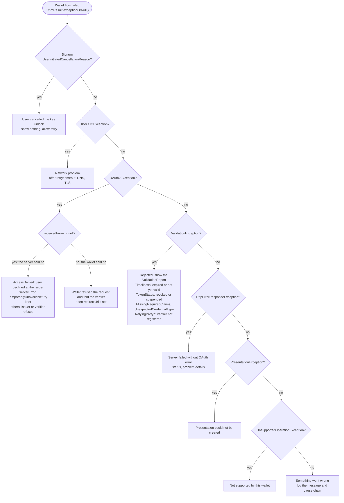

# Error reporting for wallet apps

Status: planned for 10.0.0 (unreleased). Nothing is implemented yet.

## Executive summary for app integrators

From 10.0.0 on, a failed `KmmResult` of a wallet flow (issuance, presentation, DC API) is one of a small set of
documented types. **Decide on the type, never on the message**: messages are English text for developers, meant for
logs and bug reports, and may change in any release.



### Top-level exception types, and what to tell the user

These are all the types a wallet flow can fail with, in the order to check them. The user messages are suggestions
for the app to word and localize. Where a type carries data, e.g. dates or the issuer, the app can make the message
more specific. Two things are not failures: the validation reports of credentials (`prepareCredentialStorage`) and
of presentation requests (`startAuthorizationResponsePreparation` with a policy) are returned as values, to show
before the user decides.

| # | Type (root) | When | Tell the user | App action |
|---|---|---|---|---|
| 1 | Signum `UserInitiatedCancellationReason` | The user cancelled the biometric or PIN unlock of the key | Nothing, or "Cancelled." | Allow a retry |
| 2 | Ktor exceptions, `IOException` | No network, timeout, DNS or TLS failure | "No connection to the service. Check your internet connection and try again." | Offer a retry |
| 3 | `OAuth2Exception` with `receivedFrom != null` | The issuer, authorization server or verifier answered with an OAuth error | See the subtypes below | Log `receivedFrom` and `cause` (HTTP details) |
| | ↳ `AccessDenied` | The user declined at the authorization server, or it refused | "The request was declined at {issuer}." | Back to the start |
| | ↳ `ServerError`, `TemporarilyUnavailable` | The server is down or overloaded | "The service is temporarily unavailable. Please try again later." | Offer a retry later |
| | ↳ `InvalidGrant`, `InvalidToken` | Authorization code or token expired or already used | "Your session has expired. Please start again." | Restart the flow |
| | ↳ `CredentialRequestDenied` | The issuer refuses to issue this credential | "{issuer} did not issue the credential." | — |
| | ↳ any other, incl. `Other(error)` | The server rejected the request, e.g. `invalid_proof` | "The service could not process the request." | Offer a bug report |
| 4 | `OAuth2Exception` with `receivedFrom == null` | The wallet refused a verifier's request, and has told the verifier | "This request can't be answered. The requesting service has been informed." | Open `redirectUri` if set (required by OpenID4VP 1.0, 8.2) |
| 5 | `ValidationException` | A credential, issuer or relying party did not pass validation | See the subtypes below | — |
| | ↳ `Rejected` | An operation needed an accepted report, see *Validation reports* below | Derive it from `report`, e.g. "The issuer is not trusted." | Show the report |
| | ↳ `Timeliness` | Expired or not yet valid | "The credential expired on {notAfter}." / "... is valid from {notBefore}." | — |
| | ↳ `TokenStatus` | Revoked or suspended by its issuer | "The issuer has revoked this credential." | — |
| | ↳ `MissingRequiredClaims` | The issuer left out claims the type requires | "The credential is incomplete." | Offer a bug report to the issuer |
| | ↳ `UnexpectedCredentialType` | The issuer sent another credential than requested | "The issuer sent a different credential than requested." | — |
| | ↳ `RelyingParty.*` | The verifier is not registered for this data, or can't be identified | "{verifier} is not registered to request this data." | Don't present |
| 6 | `HttpErrorResponseException` | The server failed without an OAuth error | "The service reported an error. Please try again later." | Log `status` and `problemDetails` |
| 7 | `PresentationException` | The wallet could not create the presentation | "The credential could not be presented." | Offer a bug report |
| 8 | `UnsupportedOperationException` | A feature VC-K does not support | "This isn't supported by your wallet." | — |
| 9 | Anything else, e.g. `IllegalArgumentException`, `IllegalStateException` | Malformed data, a bug, or a misconfigured wallet | "Something went wrong." | Offer a bug report with message and cause chain |

What changes for apps that integrate VC-K today:

| Situation | Until 9.x | From 10.0.0 |
|---|---|---|
| User declines at the authorization server | `Exception("No authn code in ...")` | `OAuth2Exception.AccessDenied`, `receivedFrom` = authorization server |
| Issuer or authorization server answers with an OAuth error | `HttpErrorResponseException`, code as string in `oauth2Error.error` | `OAuth2Exception` subclass, e.g. `InvalidProof`; HTTP details in `cause` |
| Server is down or overloaded | String code `server_error` / `temporarily_unavailable` | `OAuth2Exception.ServerError` / `TemporarilyUnavailable` |
| Presentation fails, wallet sends an error to the verifier | The original exception; verifier's `redirect_uri` dropped | The `OAuth2Exception` that was sent; original in `cause`; `redirectUri` to open |
| A credential can't be stored: `storeAfterUserConsent` of one that isn't intact, or the legacy `storeCredential` | Cause of the first failed check; report lost | `ValidationException.Rejected` with the whole `ValidationReport` |
| Expired, revoked, missing claims, relying party not registered | Seven unrelated exception classes | Nested under `ValidationException`; old names deprecated |
| Network failure | Ktor exception (undocumented) | Ktor exception, unchanged, documented and tested |
| User cancels biometric unlock | Signum exception, sometimes wrapped | Signum `UserInitiatedCancellationReason`, never wrapped |
| Verifier receives the wallet's error | Internal exception message as `error_description` | No description unless it is a protocol error |

Migration: old exception names stay as deprecated typealiases in 10.0.0 and are removed in 11.0.0. The breaking
changes are listed in the CHANGELOG, and the README gets a section "Handling errors in a wallet app".

### Validation reports, and how they relate to errors

Before the wallet stores a credential or answers a verifier, VC-K returns a `ValidationReport`: every check with its
outcome, and a `decision` under the app's `ValidationPolicy`. A rejected report is **not a failure**: the call
succeeds, and the app shows the report and decides with the user.

| Where | Function | Report |
|---|---|---|
| Issuer metadata | `OpenId4VciKtorClient.loadIssuerMetadata(issuer, policy)` | `LoadedIssuerMetadata.Signed.validation.report` |
| Received credentials | `CredentialIssuanceResult.Success.prepareCredentialStorage(holder, policy)`, `HolderAgent.prepareCredentialStorage` | `PreparedCredentialStorage.validation.report` |
| Verifier's request | `OpenId4VpKtorHolder.startAuthorizationResponsePreparation(input, policy)` | `AuthorizationRequestValidation.validationReport`, `relyingParty` |
| DC API request | `OpenId4VpKtorHolder.prepareDcApiRequest(request, policy)` | `DcApiRequestValidation` |
| A thrown error | — | `ValidationException.Rejected.report` |

- **Same types, same messages.** A check that didn't pass holds its reason as `CheckOutcome.Failed(throwable)` or
  `Blocked(cause)` (read it with `outcome.cause()`), and those reasons are the same `ValidationException` subtypes as
  thrown errors. One function from `ValidationException` to a user message serves both.
- **A report becomes an error** only when an operation needs an accepted report and gets a rejected one, or the user
  can't accept it. `ValidationException.Rejected` then carries the report.
- **Storing a credential has three outcomes:** accepted → `storeAccepted`; rejected but intact
  (`validation.unacceptedCredential != null`, e.g. untrusted issuer, expired, revoked, missing claims) → show the report,
  and `storeAfterUserConsent` if the user accepts; not intact (invalid signature, another key) → can't be stored,
  `storeAfterUserConsent` fails with `Rejected`.
- **Displaying a report:** headline from `decision`; list every `namedChecks` entry that is not `satisfied`, also in
  `children`; show *Failed* ("not trusted") apart from *Blocked* ("could not be checked", e.g. offline or not
  configured); key labels by the type of `checks` and the check's `name`; show `OPTIONAL` checks as notes; take
  details from `trust`, `statusMechanism`, `claims` and `outcome.cause()`. Reports carry no claim values, and
  `untrustedRegistrations` / `untrustedMetadata` are shown only marked as unverified.

The HTML version of this summary, [wallet-error-reporting-summary.html](wallet-error-reporting-summary.html), has Kotlin
examples for issuance, presentation and the message function.

### Why documented types, and not checked exceptions

The compiler can't force an app to handle every failure of a wallet flow, in Kotlin or in Swift. What VC-K can
offer, and what this plan does, is a small set of sealed root types, a list of them in the KDoc of every entry point,
and tests that keep that list true. The reasons:

- **Kotlin has no checked exceptions.** No Kotlin signature can declare "fails only with these types", and the
  compiler checks no `catch`. `@Throws` only changes how a function is exported to Java and Objective-C.
- **Swift only sees untyped errors.** Swift reaches VC-K through Kotlin/Native's Objective-C export. A Kotlin function
  annotated with `@Throws` becomes a Swift `throws` function, but the error is an `NSError` that wraps the Kotlin
  exception, never a specific type. Swift 6 has typed throws (`throws(MyError)`), but Objective-C has no equivalent,
  so the export can't produce it. Worse, an exception whose type is not listed in `@Throws` doesn't become an error at
  all: it terminates the app. That is why VC-K's public API returns `KmmResult` instead of throwing. Swift always gets
  a value, never a crash, and the failure is a `KotlinThrowable` to cast with `as?`.
- **Sealed doesn't reach Swift.** A sealed Kotlin class is exported as an ordinary Objective-C class hierarchy, with
  nested classes flattened into names like `OAuth2ExceptionAccessDenied`. Swift can't `switch` over it exhaustively,
  and adding a subclass breaks no Swift build. Kotlin callers get exhaustive `when`s once they've narrowed to a root,
  e.g. `when (e: ValidationException)`.
- **A typed error channel would still need a catch-all.** A `Result<T, WalletError>` would force VC-K to wrap every
  foreign failure into its own type: Ktor's network exceptions, Signum's user cancellation, bugs. That would hide the
  types apps need most (decision 8), and the sealed type would still need an "anything else" case, so the app would
  gain no exhaustiveness. The same holds for a classifier on top (`WalletFailure`), which was dropped for this reason.
- **The protocols are open-ended.** OAuth, OpenID4VCI and OpenID4VP allow error codes that aren't defined yet, so
  `OAuth2Exception` needs `Other(error)`, and any `when` over it a branch for that.

So an app relies on the contract in this order:

1. the type of the failure, checked from the root types down (see the chart);
2. the KDoc of the entry point, which lists the types it fails with;
3. the CHANGELOG, which marks every change of that list as BREAKING.

## Goal

A wallet app uses VC-K for issuance (OpenID4VCI) and presentation (OpenID4VP, DC API) and wants to tell its user
what went wrong. Exception messages are never shown to users: they are for developers, who read them in logs or bug
reports. So the app has to tell failures apart by **type**, and VC-K has to throw a small, documented set of types,
each carrying the data a user-facing message needs.

This plan:

1. Fixes where VC-K loses or hides the reason today (authorization server errors, errors sent to verifiers, bare
   `Exception`s, `TODO()`s in public paths).
2. Makes `OAuth2Exception` the type of every OAuth error, whether the wallet received it or created it.
3. Puts the validation exceptions under one sealed root, `ValidationException`.
4. Writes down the rules, so new code keeps to them.

## Current state

All wallet entry points return `KmmResult<T>`. A failure is an untyped `Throwable`, and the KDoc of the flow methods
does not say which failures to expect.

- **Validation outcomes are already well typed.** `ValidationReport` with `ValidationDecision`, the sealed
  `CheckOutcome` and one data class of checks per artifact (`CredentialChecks`, `RequestObjectChecks`, ...)
  ([ValidationReport.kt](../vck/src/commonMain/kotlin/at/asitplus/wallet/lib/validation/ValidationReport.kt)). This
  plan keeps them as they are. The typed check field tells the app *which* check failed.
- **Validation exceptions with data** are scattered over two packages, with no common supertype, all extending
  `IllegalArgumentException`:
  - `TokenStatusException`, `TimelinessException`, `UnregisteredRequestException`, `MissingRequiredClaimException`
    ([ValidationExceptions.kt](../vck/src/commonMain/kotlin/at/asitplus/wallet/lib/validation/ValidationExceptions.kt))
  - `MissingRegistrationCertificateException`, `InvalidRegistrationCertificateException`,
    `UnsupportedWrpRequestException`
    ([WrpRequestExceptions.kt](../vck/src/commonMain/kotlin/at/asitplus/wallet/lib/agent/validation/relyingParty/WrpRequestExceptions.kt))
- **`OAuth2Exception`** ([OAuth2Exception.kt](../vck-openid/src/commonMain/kotlin/at/asitplus/wallet/lib/oidvci/OAuth2Exception.kt))
  is sealed, with 23 subclasses. It extends `Throwable`, not `Exception`. It is used on the server side, and on the
  wallet side for errors the wallet sends to a verifier. `OAuth2ExceptionSerializer.selectDeserializer` throws
  `NotImplementedError`, so a received error can't be decoded into one.
- **Errors received from servers** arrive as `HttpErrorResponseException`, with the OAuth error as the data class
  `OAuth2Error` (a string code) ([HttpErrorResponseException.kt](../vck-openid/src/commonMain/kotlin/at/asitplus/wallet/lib/HttpErrorResponseException.kt)).
  It is created in [HttpExchanges.kt:127](../vck-openid/src/commonMain/kotlin/at/asitplus/wallet/lib/oauth2/HttpExchanges.kt:127)
  and [:174](../vck-openid/src/commonMain/kotlin/at/asitplus/wallet/lib/oauth2/HttpExchanges.kt:174), and in the Ktor
  response validation ([HttpClient.kt:47](../vck-openid-ktor/src/commonMain/kotlin/at/asitplus/wallet/lib/ktor/openid/HttpClient.kt:47)).
- **An authorization server's error redirect is lost.** `?error=access_denied&error_description=...` is parsed into
  `AuthenticationResponseParameters`, which has `error`, `errorDescription` and `errorUri`, but
  [OAuth2ProtocolClient.kt:277](../vck-openid/src/commonMain/kotlin/at/asitplus/wallet/lib/oauth2/OAuth2ProtocolClient.kt:277)
  only reads `code`, and otherwise throws `Exception("No authn code in $url")`. The redirect's `state` is not compared
  with the `state` the wallet sent, and `iss` is not checked.
- **Developer messages reach verifiers.** `Throwable.toOAuth2Error`
  ([OpenId4VpHolder.kt:447](../vck-openid/src/commonMain/kotlin/at/asitplus/wallet/lib/openid/OpenId4VpHolder.kt:447))
  sends every exception that is not an `OAuth2Exception` as `invalid_request`, with its `message` as
  `error_description`.
- **`finalizeAuthorizationResponse` rethrows the original exception**, not the error it sent
  ([OpenId4VpKtorHolder.kt:238](../vck-openid-ktor/src/commonMain/kotlin/at/asitplus/wallet/lib/ktor/openid/OpenId4VpKtorHolder.kt:238)).
  `sendAuthnErrorResponse` swallows a failure to send, drops the verifier's `redirect_uri`, and only logs an error for
  the DC API ("Unsupported error response mode").
- **Rejected reports are thrown away where an operation fails on them.** `HolderAgent.storeAccepted` returns a
  rejected credential as a result without a stored entry, which is fine. But the legacy `HolderAgent.storeCredential`
  ([HolderAgent.kt:93](../vck/src/commonMain/kotlin/at/asitplus/wallet/lib/agent/HolderAgent.kt:93)) and
  `storeAfterUserConsent` for a credential that is not intact
  ([:202](../vck/src/commonMain/kotlin/at/asitplus/wallet/lib/agent/HolderAgent.kt:202)) throw
  `report.firstRejection()`, and
  `parseCredentialMetadata` throws `IllegalArgumentException("The signed metadata have been rejected, see their
  report")` ([OpenId4VciProtocolClient.kt:206](../vck-openid/src/commonMain/kotlin/at/asitplus/wallet/lib/oidvci/OpenId4VciProtocolClient.kt:206)).
- **Network errors already pass through unchanged.** `HttpClient.execute` sends with Ktor, and `catching` wraps the
  exception once. The request object fetch of OpenID4VP takes the same path. Nothing tests this.
- **Signum's exceptions** (`CryptoException`, `Asn1Exception`, `InvalidSignature`, `UserInitiatedCancellationReason`,
  ...) also pass through. Some get wrapped, e.g. in `PresentationException(cause)`, so a user cancellation can end up
  buried in a cause chain.

## Confirmed decisions

1. **Messages are for developers only.** They are English and never shown to users. They may name identifiers (a
   credential type, a client identifier, a URL without query), but never tokens, authorization codes, nonces, claim
   values, disclosures or keys. This extends the existing rule for validation messages in
   [ARCHITECTURE.md](../ARCHITECTURE.md) (*Validation*).
2. **Only `OAuth2Exception` descriptions go to a remote party.** Any other `Throwable` sent to a verifier becomes
   `invalid_request` without `error_description`, which is optional (RFC 6749, 4.1.2.1).
3. **No bare `Exception` or `Throwable`.** Each site picks the type by what went wrong: `require` /
   `IllegalArgumentException` for a defect in the input, `check` / `IllegalStateException` for caller misuse or missing
   configuration, `UnsupportedOperationException` for a feature VC-K does not support, `SerializationException`
   inside a kotlinx serializer, and an `OAuth2Exception` where the error goes to the other party.
4. **`NotImplementedError` only in deprecated methods.** The three deprecated Token Exchange methods keep theirs. The
   `OAuth2ExceptionSerializer` gets a real deserializer, and the two `TODO()`s in the DCQL X.509 code throw
   `UnsupportedOperationException`.
5. **`OAuth2Exception` is thrown for every OAuth error, also a received one.**
   - It extends `Exception` instead of `Throwable`.
   - When the body of an error response carries an OAuth `error`, the exchange throws the matching `OAuth2Exception`
     subclass, with the `HttpErrorResponseException` as its `cause`, so status, headers, problem details and body stay
     available. Without an `error`, it throws the `HttpErrorResponseException` as today.
   - New subclasses: `ServerError` (`server_error`), `TemporarilyUnavailable` (`temporarily_unavailable`)
     (RFC 6749, 4.1.2.1), and `Other(error)` for every code VC-K does not model, e.g. `unauthorized_client`,
     `vp_formats_not_supported`, `wallet_unavailable` (OpenID4VP 1.0, 8.5).
   - A new property `receivedFrom: String?` tells a received error (the URL or identifier of the server) from one the
     wallet created itself (`null`). The authorization server's redirect has no HTTP cause, so checking for a cause is
     not enough.
   - A new property `redirectUri: String?` is set only on the error `finalizeAuthorizationResponse` rethrows (decision 7).
   - Both are immutable, and set through an `internal` secondary constructor of each subclass, which the factory by
     error code and an internal copy helper use. The public constructors of the subclasses stay
     `(description, cause)`. See *Step 3*.
   - Rejected alternative: a nested `OAuth2Exception.Received.*` subtree. It is explicit, but doubles the subclasses.
6. **An authorization server's error redirect throws its `OAuth2Exception`**, e.g. `AccessDenied` when the user
   declines, with `receivedFrom` set to the authorization server. Every site that parses incoming authorization
   response parameters reads `error` first. Today that is the redirect only; credential offer URLs carry no errors.
7. **`finalizeAuthorizationResponse` rethrows the `OAuth2Exception` it sent**, with the original exception as `cause`,
   and the verifier's `redirect_uri` in `redirectUri`. The wallet "MUST redirect the user agent to this URI", also for
   error responses (OpenID4VP 1.0, 8.2). A failure to send the error is attached with `addSuppressed`. A user
   cancellation (`UserInitiatedCancellationReason`) is still not sent, and is rethrown as it is. Over the DC API,
   `finalizeDcApiResponse` rethrows the same way, and `OAuth2Exception.toDcApiErrorResponse()` gives the app the error
   object to answer the platform with.
8. **Foreign exceptions pass through unchanged.** Ktor's network exceptions (timeouts, DNS, TLS) and Signum's
   exceptions reach the app as they are, so the app can decide, e.g., whether a failure is temporary. VC-K does not map
   Signum's types and does not wrap failures of its own signing calls in a type of its own. Signum's types keep
   extending `Throwable`; no upstream change is planned.
9. **One sealed root for validation exceptions**, `ValidationException`, extending `IllegalArgumentException` so that
   existing `catch` blocks keep working. The subtypes are nested, following `OAuth2Exception.InvalidRequest`, which
   also lets all of them live in one package, as Kotlin requires for sealed hierarchies:

   ```kotlin
   sealed class ValidationException(message: String, cause: Throwable? = null) :
       IllegalArgumentException(message, cause) {
       class Timeliness(message: String, val evaluatedAt: Instant, val notBefore: Instant?, val notAfter: Instant?)
       class TokenStatus(val status: TokenStatus)
       class MissingRequiredClaims(val missing: List<OpenId4VciClaimsPathPointer>)
       class UnexpectedCredentialType(val expected: String, val signed: Collection<String>)
       class Rejected(val report: ValidationReport)

       sealed class RelyingParty(message: String, cause: Throwable? = null) : ValidationException(message, cause) {
           class NoRegistrationCertificate(message: String)
           class InvalidRegistrationCertificate(message: String, cause: Throwable? = null)
           class UnsupportedRequest(message: String)
           class UnregisteredRequest(val requests: List<Pair<WrpCredentialRequest, RequestDataValidity>>)
       }
   }
   ```

   `Rejected` is thrown wherever an entry point fails because a report is rejected, so the app keeps the whole report.
   Its `cause` is the first rejection, its message the cause's message.
10. **A subtype only where the app needs data or a distinct reason.** Most checks fail with a plain
    `IllegalArgumentException`, since the typed check field already says what failed. A survey of every `Failed(...)`
    and `Blocked(...)` found one site that needs a new subtype: `UnexpectedCredentialType`
    ([CredentialEvaluation.kt:60](../vck/src/commonMain/kotlin/at/asitplus/wallet/lib/validation/CredentialEvaluation.kt:60)),
    i.e. the issuer sent another credential than the one requested. `Blocked(IllegalStateException)` means "the wallet
    is not configured for this check", `IllegalArgumentException` a defect of the artifact.
11. **`PresentationException` stays as the supertype for "could not create the presentation"**, but no longer wraps a
    cause that already has a better type, and request problems that go to the verifier become `OAuth2Exception`s.
12. **`InvalidMacException` is dropped.** It is thrown at one site, and nothing catches it by type.
13. **One release, with deprecations.** All breaking changes ship in 10.0.0 with CHANGELOG migration notes. Old names
    stay as `@Deprecated` typealiases or classes in 10.0.0, and are removed in 11.0.0.

## Exception types after this plan

See *Top-level exception types, and what to tell the user* in the executive summary. The data each type carries:

| Type | Data |
|---|---|
| `OAuth2Exception` (sealed) | `error`, `errorDescription`, `errorUri`, `receivedFrom`, `redirectUri`, `cause` |
| `HttpErrorResponseException` | `status`, `headers`, `problemDetails`, `responseBody` |
| `ValidationException` (sealed) | see decision 9 |
| `PresentationException`, `UnsupportedOperationException`, other | message, `cause` |

## Steps

Each step is one commit and compiles on its own. Leave each step uncommitted for review. The JVM tests of the
touched modules prove each step green. Before a step that changes `commonMain` API, compile the common metadata as
well (`./gradlew :vck:compileCommonMainKotlinMetadata`, same for `vck-openid` and `vck-openid-ktor`) without
`disableAppleTargets`.

| # | Commit | Gradle |
|---|---|---|
| 1 | Error messages: write down the rules, send no developer messages to verifiers | `:vck:jvmTest :vck-openid:jvmTest :openid-data-classes:jvmTest` |
| 2 | Replace bare `Exception`, `Throwable` and `TODO()` | `:vck:jvmTest :vck-openid:jvmTest :vck-openid-ktor:jvmTest :openid-data-classes:jvmTest :csc-data-classes:jvmTest :etsi-data-classes:jvmTest :sd-jwt-type-metadata:jvmTest` |
| 3 | `OAuth2Exception`: extend `Exception`, decode by error code, new subclasses, copy helper | `:vck-openid:jvmTest` |
| 4 | Throw received OAuth errors as `OAuth2Exception` | `:vck-openid:jvmTest :vck-openid-ktor:jvmTest` |
| 5 | Authorization redirect: throw its error, check `state` and `iss` | `:openid-data-classes:jvmTest :vck-openid:jvmTest :vck-openid-ktor:jvmTest` |
| 6 | OpenID4VP: rethrow the error sent to the verifier | `:vck-openid:jvmTest :vck-openid-ktor:jvmTest` |
| 7 | `ValidationException` root with nested subtypes | `:vck:jvmTest :vck-openid:jvmTest :vck-openid-ktor:jvmTest` |
| 8 | Deprecate `InvalidMacException`, tidy `PresentationException` | `:vck:jvmTest :vck-openid:jvmTest` |
| 9 | Network pass-through test, KDoc of the wallet entry points, README | `:vck-openid-ktor:jvmTest` |

### Step 1: rules and messages

- [ARCHITECTURE.md](../ARCHITECTURE.md), next to the `KmmResult` conventions: add an *Errors* section with decisions
  1, 2, 3, 8 and 10, and the table above. Keep it short; this plan holds the reasoning.
- `Throwable.toOAuth2Error(state)` ([OpenId4VpHolder.kt:447](../vck-openid/src/commonMain/kotlin/at/asitplus/wallet/lib/openid/OpenId4VpHolder.kt:447)):
  for a `Throwable` that is not an `OAuth2Exception`, send `invalid_request` without `errorDescription`. Cite
  RFC 6749, 4.1.2.1 (`error_description` is OPTIONAL) in the KDoc.
- Remove what decision 1 forbids from messages:
  - [DCQLCredentialQuery.kt](../openid-data-classes/src/commonMain/kotlin/at/asitplus/openid/dcql/DCQLCredentialQuery.kt)
    (around line 354): the `require` message interpolates `$credentialQueryResponses`, i.e. credentials. Name the
    count only.
  - [OAuth2ProtocolClient.kt:390](../vck-openid/src/commonMain/kotlin/at/asitplus/wallet/lib/oauth2/OAuth2ProtocolClient.kt:390)
    and :422 dump `$oauthMetadata`. Name the issuer only.
- Tests: `OpenId4VpHolder` sends `invalid_request` without description for an `IllegalArgumentException`, and keeps
  the code and description of an `OAuth2Exception`.
- CHANGELOG: error responses to verifiers no longer carry the messages of internal exceptions.

### Step 2: bare `Exception`, `Throwable` and `TODO()`

| Site | New type |
|---|---|
| [OAuth2ProtocolClient.kt:279](../vck-openid/src/commonMain/kotlin/at/asitplus/wallet/lib/oauth2/OAuth2ProtocolClient.kt:279) `No authn code in $url` | `IllegalArgumentException("No authorization code in the redirect")`, without the URL. Step 5 adds the `error` handling in front of it |
| [OAuth2ProtocolClient.kt:390](../vck-openid/src/commonMain/kotlin/at/asitplus/wallet/lib/oauth2/OAuth2ProtocolClient.kt:390), :422 (endpoint missing from metadata), :438 (no `request_uri` in the PAR response) | `IllegalArgumentException` (`requireNotNull`) |
| [OAuth2Client.kt:136](../vck-openid/src/commonMain/kotlin/at/asitplus/wallet/lib/oauth2/OAuth2Client.kt:136) `SignPushedAuthorizationRequest is null` | `IllegalStateException` (`checkNotNull`) |
| [OpenId4VciKtorClient.kt:341](../vck-openid-ktor/src/commonMain/kotlin/at/asitplus/wallet/lib/ktor/openid/OpenId4VciKtorClient.kt:341) unknown credential scheme | `UnsupportedOperationException` |
| [Extensions.kt:61](../vck/src/commonMain/kotlin/at/asitplus/wallet/lib/agent/Extensions.kt:61) unsupported digest | `IllegalArgumentException` |
| [TrustListValidator.kt:35](../vck/src/commonMain/kotlin/at/asitplus/wallet/lib/etsi/TrustListValidator.kt:35) certificate not valid at a date | `TimelinessException` (renamed in step 7) with the certificate's `notBefore` / `notAfter` |
| TrustListValidator.kt:77, :79 (chain mismatch) | `IllegalArgumentException` |
| [WrprcRequestValidator.kt:179](../vck/src/commonMain/kotlin/at/asitplus/wallet/lib/agent/validation/relyingParty/registrationCertificate/WrprcRequestValidator.kt:179) (`Throwable`) | `UnsupportedWrpRequestException` |
| [WrpacIdentifier.kt:46](../vck/src/commonMain/kotlin/at/asitplus/wallet/lib/agent/validation/relyingParty/accessCertificate/WrpacIdentifier.kt:46) (`Throwable`) | `IllegalArgumentException` |
| etsi-data-classes `WrpCredentialMeta.kt:22` (`Throwable`) | `IllegalArgumentException` |
| openid-data-classes `StatusListTokenPayloadSurrogate.kt:95`, `IdentifierInfoKey.kt:41` | `SerializationException` if inside a serializer, else `IllegalArgumentException` |
| csc-data-classes `ObjectIdentifierExtension.kt:40` | `IllegalArgumentException` |
| csc-data-classes `Base64X509CertificateSerializer.kt:21`, sd-jwt-type-metadata `ContentSecurityPolicyBase64String.kt:24` | `SerializationException` |
| [DCQLCredentialMetadataAndValidityConstraints.kt:11](../openid-data-classes/src/commonMain/kotlin/at/asitplus/openid/dcql/DCQLCredentialMetadataAndValidityConstraints.kt:11) `TODO()` | `KmmResult.failure(UnsupportedOperationException(...))`. It is outside any `catching` today, so the error escapes the `KmmResult` |
| [DCQLCredentialQuery.kt:365](../openid-data-classes/src/commonMain/kotlin/at/asitplus/openid/dcql/DCQLCredentialQuery.kt:365) `TODO()` | `UnsupportedOperationException` |

Read each site before changing it: where the surrounding code already uses `require` / `check`, use those. Tests that
expect `Exception` at these sites expect the new type. CHANGELOG: list the sites whose exception type changes.

### Step 3: `OAuth2Exception`

In [OAuth2Exception.kt](../vck-openid/src/commonMain/kotlin/at/asitplus/wallet/lib/oidvci/OAuth2Exception.kt):

- Extend `Exception` instead of `Throwable`. This changes the superclass, which is binary-incompatible: CHANGELOG.
- Add `ServerError`, `TemporarilyUnavailable` and `Other(error: String, description, cause)`, with their constants in
  `OpenIdConstants.Errors` (RFC 6749, 4.1.2.1). Adding subclasses breaks exhaustive `when`s of Kotlin callers:
  CHANGELOG.
- Add an internal factory `OAuth2Exception.of(error: String, description: String?, cause: Throwable?)` that maps each
  known code to its subclass and every other one to `Other`. It is the single code-to-type table.
- Add three immutable `@Transient` properties to the base class, passed through its constructor: `errorUri: String?`,
  `receivedFrom: String?` and `redirectUri: String?`. Each subclass keeps its public primary constructor
  `(description, cause)`, which passes `null` for all three, and gets an `internal` secondary constructor
  `(description, cause, errorUri, receivedFrom, redirectUri)`. `Other` takes `error` in both.
- Extend the factory to `of(error, description, cause, errorUri, receivedFrom, redirectUri)`, using the secondary
  constructors, and add the internal copy helper `OAuth2Exception.copy(receivedFrom = ..., redirectUri = ...)`, which
  calls `of(...)` with the values of this instance and the changed ones. No exception changes after it was created.
- Implement `OAuth2ExceptionSerializer.selectDeserializer` with the factory, reading `error`, `error_description` and
  `error_uri`. Add `errorUri` to `toOAuth2Error()`.
- Tests: decode every known code to its subclass, an unknown code to `Other`; `copy` keeps type, code, description,
  `errorUri` and cause, and sets only what it is given.

### Step 4: received OAuth errors

- In `HttpExchanges` ([HttpExchanges.kt:127](../vck-openid/src/commonMain/kotlin/at/asitplus/wallet/lib/oauth2/HttpExchanges.kt:127),
  [:174](../vck-openid/src/commonMain/kotlin/at/asitplus/wallet/lib/oauth2/HttpExchanges.kt:174)) and in the Ktor
  response validation ([HttpClient.kt:47](../vck-openid-ktor/src/commonMain/kotlin/at/asitplus/wallet/lib/ktor/openid/HttpClient.kt:47)):
  after the retry decision (DPoP nonce, attestation challenge), throw `error.toThrowable(requestUrl)`. That is the
  `OAuth2Exception` of `oauth2Error`, with the `HttpErrorResponseException` as `cause` and `receivedFrom` set to the
  request URL without query, or the `HttpErrorResponseException` itself if there is no `oauth2Error`. Keep the retry
  decision on the `HttpErrorResponseException`, which has the headers.
- `OpenId4VciProtocolClient.isInvalidNonce` ([OpenId4VciProtocolClient.kt:400](../vck-openid/src/commonMain/kotlin/at/asitplus/wallet/lib/oidvci/OpenId4VciProtocolClient.kt:400))
  checks `is OAuth2Exception.InvalidNonce`.
- Update the KDoc that promises `HttpErrorResponseException`: [HttpExchange.kt:117](../vck-openid/src/commonMain/kotlin/at/asitplus/wallet/lib/HttpExchange.kt:117),
  [OpenId4VpProtocolClient.kt:55](../vck-openid/src/commonMain/kotlin/at/asitplus/wallet/lib/openid/OpenId4VpProtocolClient.kt:55)
  and :124, and `HttpClient.execute`.
- Tests: about 13 tests expect `HttpErrorResponseException`. Those with an OAuth error in the body expect the
  `OAuth2Exception` subclass, with `receivedFrom` and the HTTP details on the cause. Add one for a `problem+json` body
  without `error`, which still throws `HttpErrorResponseException`.
- CHANGELOG, BREAKING: error responses with an OAuth `error` are thrown as `OAuth2Exception`; migrate
  `(e as? HttpErrorResponseException)?.oauth2Error?.error` to `is OAuth2Exception.X` and read HTTP details from
  `cause`.

### Step 5: authorization redirect

In `OAuth2ProtocolClient.requestTokenWithAuthCode`
([OAuth2ProtocolClient.kt:262](../vck-openid/src/commonMain/kotlin/at/asitplus/wallet/lib/oauth2/OAuth2ProtocolClient.kt:262)),
before reading `code`, through one helper `AuthenticationResponseParameters.throwIfError(expected...)` that later
parsing sites reuse. The order matters: an error response is only trusted once it is known to come from the
authorization server the request went to. RFC 9207, 2.4: "For error responses, clients MUST NOT assume that the error
originates from the intended authorization server."

1. Require the redirect's `state` to equal the `state` of the authorization request. RFC 6749, 10.12: "The client
   MUST implement CSRF protection for its redirection URI", and "SHOULD utilize the "state" request parameter" for
   it. This covers the error redirect too, so an attacker can't inject an `access_denied`.
2. Require `iss` to equal `oauthMetadata.issuer` if it is present. RFC 9207, 2.4: "If the value does not match the
   expected issuer identifier, clients MUST reject the authorization response". Require `iss` to be present if the
   metadata announce `authorization_response_iss_parameter_supported`: clients "MUST reject authorization responses
   without the iss parameter from authorization servers that do support the parameter according to the client's
   configuration" (RFC 9207, 2.4). Add that field to `OAuth2AuthorizationServerMetadata`, default `false`
   (RFC 9207, 3). The parameter is also sent "in authorization responses to the client, including error responses"
   (RFC 9207, 2).
3. If `error` is present, throw `OAuth2Exception.of(error, errorDescription, errorUri = errorUri, receivedFrom =
   oauthMetadata.issuer)` (RFC 6749, 4.1.2.1).
4. Otherwise read `code`, as in step 2.

- Tests (`OAuth2ProtocolClientTest`, `OpenId4VciKtorClient*Test`): `access_denied` → `OAuth2Exception.AccessDenied`
  with description and `receivedFrom`; unknown code → `Other`; wrong `state` and wrong `iss` fail, also for an error
  redirect, before the error is thrown; missing `iss` fails only if the metadata announce it.
- CHANGELOG: `resumeWithAuthCode` fails with the authorization server's `OAuth2Exception`, and checks `state` and
  `iss`.

### Step 6: OpenID4VP error responses

In [OpenId4VpKtorHolder.kt](../vck-openid-ktor/src/commonMain/kotlin/at/asitplus/wallet/lib/ktor/openid/OpenId4VpKtorHolder.kt):

- `sendAuthnErrorResponse` returns the `OAuth2Exception` it sent: the error itself if it is one, else `invalid_request`
  (step 1), with the original as `cause`. For a POST, it reads the verifier's `redirect_uri` through
  `OpenId4VpProtocolClient.sendAuthorizationResponse`, which already parses and checks it, and sets it with
  `copy(redirectUri = ...)` (OpenID4VP 1.0, 8.2). A failure to send is added to the returned exception with
  `addSuppressed`. For a redirect response mode, `redirectUri` is the error redirect URL.
- `finalizeAuthorizationResponse` throws what `sendAuthnErrorResponse` returns. A `UserInitiatedCancellationReason`
  anywhere in the cause chain is rethrown as it is, unsent, as today.
- **DC API:** errors over the DC API are an object with only `error` inside `data`, and
  still fulfil the API's promise (OpenID4VP 1.0, Appendix A, *Response*). `finalizeDcApiResponse` rethrows the
  `OAuth2Exception` the same way, and VC-K adds `OAuth2Exception.toDcApiErrorResponse()` for the app to answer the
  platform with. Replace the "Unsupported error response mode" log.
- Tests (`OpenId4VpKtorHolderTest`): a failing presentation rethrows the sent `OAuth2Exception` with `redirectUri` from
  the verifier's answer; a failing POST of the error adds a suppressed exception; a user cancellation is not sent.
- CHANGELOG, BREAKING: `finalizeAuthorizationResponse` fails with the `OAuth2Exception` sent to the verifier; the
  original exception is its `cause`.

### Step 7: `ValidationException`

- New file `vck/src/commonMain/kotlin/at/asitplus/wallet/lib/validation/ValidationException.kt` with the root of
  decision 9. Keep the constructor parameters of the old classes, so that the typealiases still construct them.
- Replace the old classes by `@Deprecated(..., ReplaceWith(...))` typealiases in their old files and packages:
  `TokenStatusException`, `TimelinessException`, `MissingRequiredClaimException`, `UnregisteredRequestException`,
  `MissingRegistrationCertificateException`, `InvalidRegistrationCertificateException`,
  `UnsupportedWrpRequestException`. Move every use in VC-K to the new names, including the type check in
  [RelyingPartyValidator.kt:237](../vck/src/commonMain/kotlin/at/asitplus/wallet/lib/validation/RelyingPartyValidator.kt:237).
- `Rejected(report)`: throw it where `HolderAgent` throws `firstRejection()` today, i.e. the legacy
  `storeCredential` ([HolderAgent.kt:93](../vck/src/commonMain/kotlin/at/asitplus/wallet/lib/agent/HolderAgent.kt:93))
  and `storeAfterUserConsent` for a credential that is not intact
  ([:202](../vck/src/commonMain/kotlin/at/asitplus/wallet/lib/agent/HolderAgent.kt:202)), and in
  `OpenId4VciProtocolClient.parseCredentialMetadata(loaded)`
  ([OpenId4VciProtocolClient.kt:206](../vck-openid/src/commonMain/kotlin/at/asitplus/wallet/lib/oidvci/OpenId4VciProtocolClient.kt:206)).
  The rejection of a request object stays an `OAuth2Exception`, because it is sent to the verifier, and the app has
  its report from `AuthorizationRequestValidation`.
- `UnexpectedCredentialType(expected, signed)` in `expectedIdentifier`
  ([CredentialEvaluation.kt:60](../vck/src/commonMain/kotlin/at/asitplus/wallet/lib/validation/CredentialEvaluation.kt:60)).
- Align the meaning of `Blocked` (decision 10): "No trust scope covers $credentialIdentifier"
  ([TrustCheck.kt:134](../vck/src/commonMain/kotlin/at/asitplus/wallet/lib/validation/TrustCheck.kt:134)) and "No
  metadata describe the claims of $identifier"
  ([RequiredClaims.kt:130](../vck/src/commonMain/kotlin/at/asitplus/wallet/lib/validation/RequiredClaims.kt:130))
  are missing configuration and become `IllegalStateException`. "The credential type is ambiguous"
  ([CredentialValidator.kt:166](../vck/src/commonMain/kotlin/at/asitplus/wallet/lib/validation/CredentialValidator.kt:166),
  [RequiredClaims.kt:126](../vck/src/commonMain/kotlin/at/asitplus/wallet/lib/validation/RequiredClaims.kt:126),
  [StatusValidator.kt:248](../vck/src/commonMain/kotlin/at/asitplus/wallet/lib/validation/StatusValidator.kt:248))
  is about the artifact and stays `IllegalArgumentException`.
- Tests: the existing tests of the typed exceptions use the new names; `storeAfterUserConsent` of a credential that
  is not intact, and `storeCredential` of a rejected one, throw `Rejected` with the report; `storeAccepted` of a
  rejected credential still succeeds without a stored entry; a credential of another type fails `semantics` with
  `UnexpectedCredentialType`.
- CHANGELOG: new `ValidationException`; the old names are deprecated typealiases; `Rejected` replaces the first
  rejection's cause as the thrown exception.

### Step 8: `InvalidMacException` and `PresentationException`

- `VerifyMac` ([CryptoService.kt:64](../vck/src/commonMain/kotlin/at/asitplus/wallet/lib/agent/CryptoService.kt:64))
  fails with `require(realTag contentEquals tag)`. `InvalidMacException` stays as a `@Deprecated` class, no longer
  thrown, removed in 11.0.0.
- `PresentationException` stops wrapping causes that already have a better type:
  [VerifiablePresentationFactory.kt:255](../vck/src/commonMain/kotlin/at/asitplus/wallet/lib/agent/VerifiablePresentationFactory.kt:255),
  :285, :308, :424, :480 let the cause through, so a `UserInitiatedCancellationReason` or a `ValidationException`
  reaches the app as it is.
- Request problems become `OAuth2Exception`s, so that the verifier gets the right code (OpenID4VP 1.0, 8.5):
  - QES approval with missing or unknown `credential_ids`, no credential to authorize it, more than one approval
    ([PresentationResponseCreator.kt:122](../vck/src/commonMain/kotlin/at/asitplus/wallet/lib/agent/PresentationResponseCreator.kt:122),
    :125, :138, :149; [VerifiablePresentationFactory.kt:454](../vck/src/commonMain/kotlin/at/asitplus/wallet/lib/agent/VerifiablePresentationFactory.kt:454))
    → `InvalidTransactionData`.
  - Unsupported QES approval hash algorithm (:457) → `InvalidTransactionData`.
  - "calcIsoSessionTranscript not implemented" (:248) → `UnsupportedOperationException`.
- The other sites stay `PresentationException`: credentials missing from the store, no credential for a document
  request, ISO metadata incompatible, no ZK backend.
- Tests: the 6 `shouldThrow<PresentationException>` are checked site by site.
- CHANGELOG: deprecations, and the changed types of these sites.

### Step 9: tests and documentation

- Network pass-through test in `vck-openid-ktor`: a `MockEngine` that throws an `IOException` (and one that times
  out) makes `loadCredentialOffer`, `resumeWithAuthCode` and `startAuthorizationResponsePreparation` fail with exactly
  that exception, not wrapped.
- KDoc of each wallet entry point lists its failures with the types of this plan:
  - `OpenId4VciKtorClient`: `loadCredentialOffer`, `loadCredentialMetadata`, `loadIssuerMetadata`,
    `startProvisioningWithAuthRequestReturningResult`, `resumeWithAuthCode`, `refreshCredentialReturningResult`,
    `loadCredentialWithOfferReturningResult`, `CredentialIssuanceResult.Success.prepareCredentialStorage`
  - `OpenId4VpKtorHolder`: `startAuthorizationResponsePreparation`, `prepareDcApiRequest`, `getMatchingCredentials`,
    `finalizeAuthorizationResponse`, `finalizeDcApiResponse`, `sendAuthnErrorResponse`
  - `HolderAgent`: `prepareCredentialStorage`, `storeAccepted`, `storeAfterUserConsent`
- [README.md](../README.md): a section "Handling errors in a wallet app", with the chart and the table of top-level
  exception types from the executive summary, and a short `when` over a failed `KmmResult`.
- CHANGELOG: one summary entry pointing to the README section.

## Verification

- Every step: the Gradle command of its row, green, and the common metadata compile for steps that change public API.
- After step 9: `./gradlew :vck:jvmTest :vck-openid:jvmTest :vck-openid-ktor:jvmTest` and the data-class modules
  touched in step 2.
- Searches that must come back empty in `src/commonMain` of all modules, deprecated Token Exchange methods excepted:
  `throw Exception(`, `throw Throwable(`, `NotImplementedError`, `TODO(`.

## Out of scope

- Mapping Signum's exceptions, and changing their supertype in Signum (decision 8).
- Typing the cause of `CheckOutcome.Failed` beyond the subtypes of decision 9.
- Log output (`Napier`), which the app configures.
- A wallet-side classifier of failures (a sealed `WalletFailure`); dropped as without benefit.

## References

| Source | Used for |
|---|---|
| RFC 6749, 4.1.2.1 (Error Response) | Error redirect parameters, `server_error`, `temporarily_unavailable`, optional `error_description` |
| RFC 6749, 10.12 (Cross-Site Request Forgery) | `state` check of the redirect |
| RFC 9207, 2 (Response Parameter iss) | `iss` is sent in error responses too |
| RFC 9207, 2.4 (Validating the Issuer Identifier) | `iss` check, and not trusting an error before it |
| RFC 9207, 3 (Authorization Server Metadata) | `authorization_response_iss_parameter_supported` |
| OpenID4VP 1.0, 8.2 (Response Mode "direct_post") | `redirect_uri` in the answer to an error response, which the wallet MUST follow |
| OpenID4VP 1.0, 8.5 (Error Response) | Error codes sent to verifiers, e.g. `invalid_transaction_data` |
| OpenID4VP 1.0, Appendix A (OpenID4VP over the Digital Credentials API), *Response* | DC API error object with only `error` |
| OpenID4VCI 1.0, 5.3 (Authorization Error Response), 6.3 (Token Error Response), 8.3.1 (Credential Error Response) | Errors the wallet receives during issuance |
